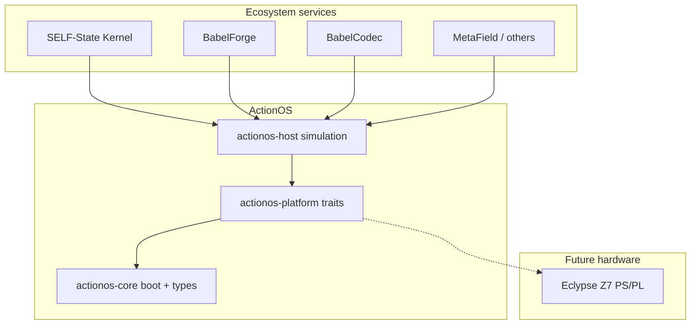

# Architecture — ActionOS Platform Foundation

## Purpose

ActionOS is the **platform** layer: boot, hardware boundaries, resource lifecycle, and system composition. Ecosystem services run *on* or *alongside* ActionOS through adapters — they are not reimplemented inside it.

## Layering

## Crates

| Crate | `std`? | Responsibility |
|-------|--------|----------------|
| `actionos-core` | no | Boot phases, errors, memory regions, IDs |
| `actionos-platform` | no | Traits only |
| `actionos-host` | yes | Simulation, tests, binary |

## Explicit non-ownership

- No PolicyEngine / capability authorization (BabelForge)
- No append-only execution journal (BabelForge)
- No SELF.GET/SET state authority (SELF-State Kernel)
- No Unicode canonicalization engine (BabelCodec)
- No fabricated MMIO drivers for Eclypse Z7 in v0.1

## Boot vs action lifecycle

BabelForge: `DISCOVER → INSPECT → AUTHORIZE → EXECUTE → VERIFY → RECORD`

ActionOS: `RESET → EARLY_INIT → MEMORY_READY → PLATFORM_READY → SERVICES_READY → RUNNING`
